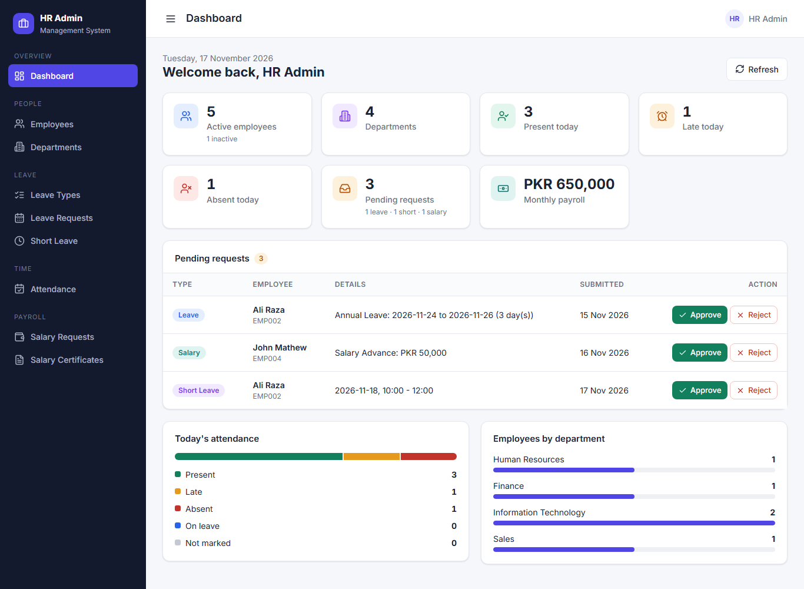
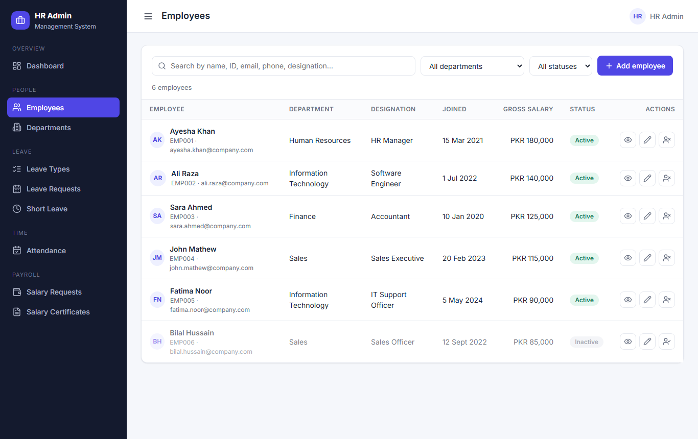
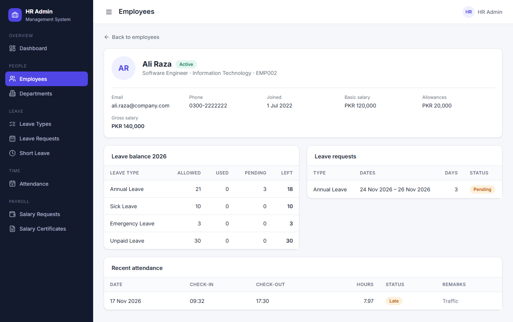
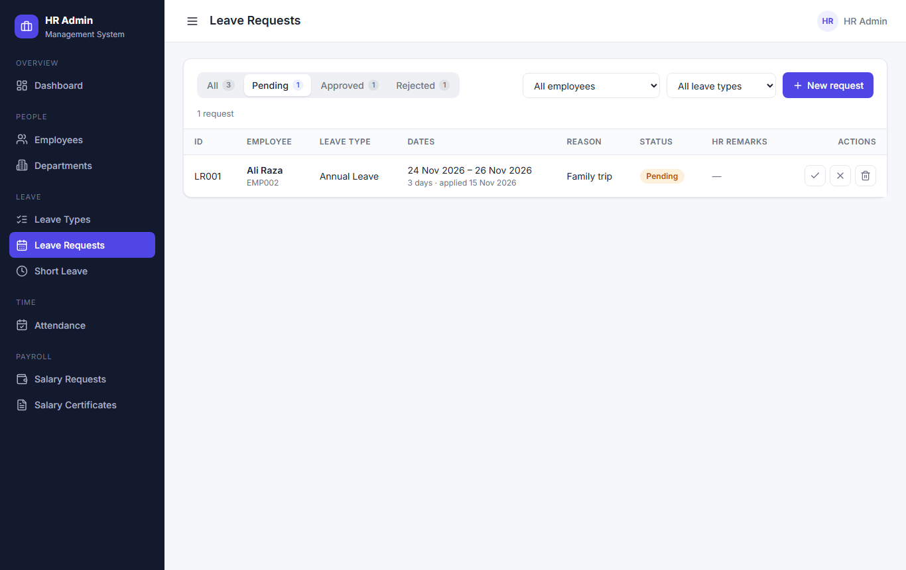
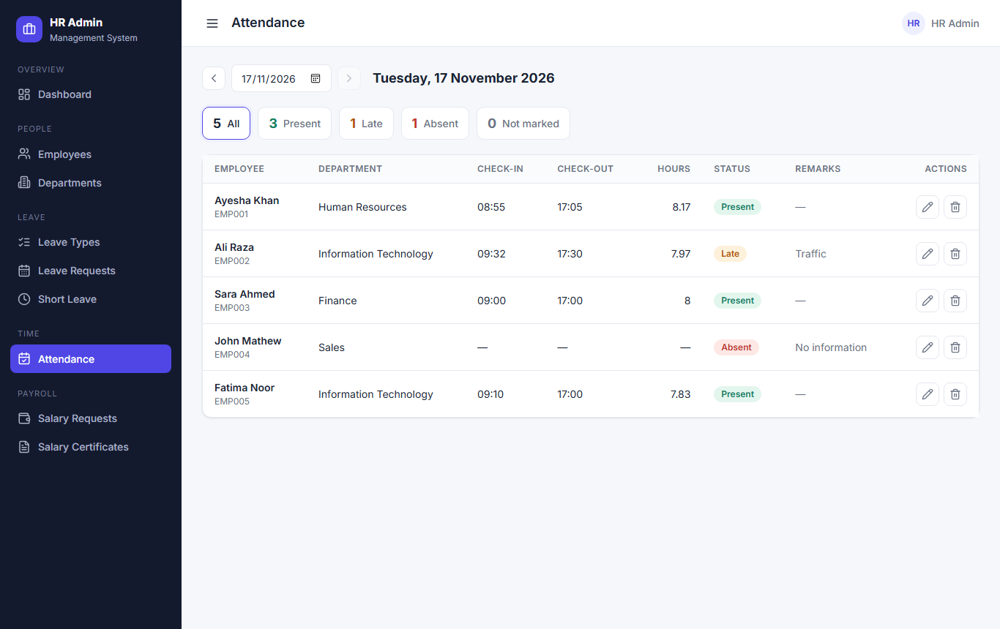
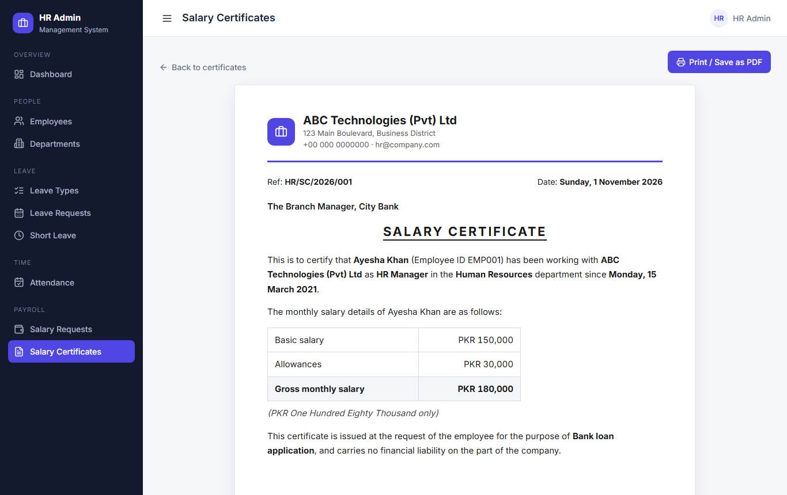

# Mini HR Admin Management System

A web app for an HR Admin to manage employees, departments, leave, short leave,
attendance, salary requests and salary certificates — with a live dashboard.

**Student project** · React (Vite) frontend · Python FastAPI REST API · **JSON files for storage (no database)**



---

## Contents
1. [Features](#features)
2. [Technology](#technology)
3. [Install (first time only)](#install-first-time-only)
4. [Run the project](#run-the-project)
5. [Run the automatic tests](#run-the-automatic-tests)
6. [How it works](#how-it-works)
7. [Project structure](#project-structure)
8. [JSON data files](#json-data-files)
9. [API endpoints](#api-endpoints)
10. [Business rules and validation](#business-rules-and-validation)
11. [Screenshots](#screenshots)
12. [Troubleshooting](#troubleshooting)

---

## Features
| # | Module | What the HR Admin can do |
|---|---|---|
| 1 | **Employee Master** | Add, edit, view, search, filter by department/status, deactivate and reactivate. Profile page with leave balance and attendance history |
| 2 | **Department Master** | Add, edit, delete (blocked while the department has employees), choose a head of department |
| 3 | **Leave Master** | Annual, Sick, Emergency and Unpaid leave (add more), days per year, paid / unpaid |
| 4 | **Leave Requests** | Submit for an employee, live day count and balance, approve / reject with remarks, cancel |
| 5 | **Short Leave** | Employee, date, from time, to time, reason, status (max 4 hours) |
| 6 | **Attendance** | Daily sheet: check-in / check-out, status worked out automatically (Present / Late / Absent) |
| 7 | **Salary Requests** | Advance, increment, correction, loan, other — approve / reject |
| 8 | **Salary Certificates** | Generate from employee data, printable letter with amount in words, save as PDF |
| 9 | **HR Dashboard** | Summary cards, today's attendance, employees per department, all pending requests with one-click approve / reject |

Every change is saved straight back to the JSON files.

---

## Technology
| Part | Technology | Why |
|---|---|---|
| Frontend | React 18 + Vite 5, React Router, Lucide icons | Fast dev server, reusable components, page routing |
| Backend | Python 3.10+ with FastAPI, Uvicorn | Simple REST API, automatic validation and docs (`/docs`) |
| Validation | Pydantic (comes with FastAPI) | Checks every request before it reaches the data |
| Storage | One JSON file per module in `backend/data/` | Required by the assignment (no database) |
| Tools | VS Code, Git, GitHub | Editing and version control |

---

## Install (first time only)
You need **Python 3.10+**, **Node.js 18+** and **Git**.

```bash
git clone https://github.com/usmanshabbir89-hash/HR-ADMIN.git
cd HR-ADMIN
```

**Backend:**
```bash
cd backend
python -m venv venv
venv\Scripts\activate
pip install -r requirements.txt
cd ..
```

**Frontend:**
```bash
cd frontend
npm install
cd ..
```

> On some Windows PCs the Python command is `py` instead of `python` (for example `py -m venv venv`).
> On macOS / Linux use `source venv/bin/activate` instead of `venv\Scripts\activate`.

---

## Run the project

### Option A — one click (Windows)
Double-click **`start.bat`**. It opens two windows (backend and frontend) and then the app in your browser.
Close the two windows to stop.

### Option B — two terminals
**Terminal 1 — backend**
```bash
cd backend
venv\Scripts\activate
uvicorn main:app --reload
```
**Terminal 2 — frontend**
```bash
cd frontend
npm run dev
```

| Open | Address |
|---|---|
| **The app** | http://localhost:5173 |
| API documentation (try every endpoint) | http://127.0.0.1:8000/docs |
| API health check | http://127.0.0.1:8000/api/health |

---

## Run the automatic tests
```bash
cd backend
venv\Scripts\activate
python test_api.py
```
The script copies the data to a temporary folder, starts a test server on port 8001, sends real requests
to **every module** and prints `PASS` / `FAIL` for each check. Your real data is never changed.

```
Result: 59/59 checks passed
```

---

## How it works

```
 Browser (React, port 5173)
     │  fetch("/api/...")          ← all calls go through frontend/src/api.js
     ▼
 Vite dev server  ── proxy /api ──►  FastAPI (port 8000)
                                         │ 1. Pydantic checks the input      (schemas.py)
                                         │ 2. Router checks business rules   (routers/*.py)
                                         │ 3. Read / change / save JSON      (storage.py)
                                         ▼
                                   backend/data/*.json
```

**Request life cycle** (leave, short leave, salary):
```
 submit ──► Pending ──approve──► Approved
               │  └──reject (remarks required)──► Rejected
               └──cancel──► (removed)
 Approved / Rejected requests are final.
```

**Safe JSON writing** (`storage.py`): data is written to a temporary file first and then swapped in
with one `os.replace()` call, so a crash can never leave a half-written, broken JSON file.
A lock stops two saves from happening at the same time.

**Linking with employee IDs**: every request, attendance record and certificate stores an
`employee_id` (e.g. `EMP002`). Employees are **deactivated, never deleted**, so old records keep working.

---

## Project structure
```
HR-ADMIN/
├── start.bat                  One-click start (Windows)
├── README.md
├── docs/screenshots/          Images used in this README
├── backend/
│   ├── main.py                Starts FastAPI, connects all routers, CORS, error handler
│   ├── storage.py             Safe JSON read / write, ID generator
│   ├── schemas.py             Validation rules for every form (Pydantic)
│   ├── helpers.py             Shared rules: active employee, approve / reject / cancel
│   ├── settings.py            Company name, currency, office start / late time
│   ├── test_api.py            Automatic tests (59 checks)
│   ├── requirements.txt       Python packages
│   ├── data/                  The JSON "database" (8 files)
│   └── routers/               One file of endpoints per module
│       ├── employees.py         departments.py        leave_types.py
│       ├── leave_requests.py    short_leaves.py       attendance.py
│       ├── salary_requests.py   salary_certificates.py
│       └── dashboard.py
└── frontend/
    ├── index.html, vite.config.js, package.json
    └── src/
        ├── main.jsx           Starts React
        ├── App.jsx            URL → page map
        ├── navigation.js      Sidebar menu
        ├── api.js             All calls to the backend + readable errors
        ├── utils.js           Money / date formatting, number to words
        ├── index.css          All styling (+ print styles for certificates)
        ├── components/        Reusable pieces: Layout, Modal, forms, badges, dialogs …
        └── pages/             One file per screen
```

---

## JSON data files
All files are in `backend/data/` and each holds a **list** of records.

| File | ID format | Key fields |
|---|---|---|
| `employees.json` | `EMP001` | full_name, email, phone, department_id, designation, join_date, basic_salary, allowances, status |
| `departments.json` | `DEP01` | name, code, head_employee_id, description, status |
| `leave_types.json` | `LT01` | name, code, days_per_year, is_paid, description |
| `leave_requests.json` | `LR001` | employee_id, leave_type_id, start_date, end_date, days, reason, status, applied_on, reviewed_on, hr_remarks |
| `short_leave_requests.json` | `SL001` | employee_id, date, from_time, to_time, hours, reason, status, applied_on, reviewed_on, hr_remarks |
| `attendance.json` | `AT001` | employee_id, date, check_in, check_out, status, remarks |
| `salary_requests.json` | `SR001` | employee_id, request_type, amount, reason, status, requested_on, reviewed_on, hr_remarks |
| `salary_certificates.json` | `SC001` | certificate_no, employee_id, employee_name, designation, department_name, join_date, basic_salary, allowances, total_salary, issue_date, purpose, addressed_to |

The dashboard has no file of its own — it counts from the other files.

---

## API endpoints
Full interactive list: **http://127.0.0.1:8000/docs**

| Method | Path | Purpose |
|---|---|---|
| GET | /api/health | Checks every JSON file can be read |
| GET | /api/employees?search=&department_id=&status= | List employees with search and filters |
| GET | /api/employees/{id} | View one employee |
| POST | /api/employees | Add employee |
| PUT | /api/employees/{id} | Edit employee |
| PATCH | /api/employees/{id}/deactivate · /activate | Change status |
| GET · POST | /api/departments | List (`?search=`) / add departments |
| GET · PUT · DELETE | /api/departments/{id} | View / edit / delete (only if it has no employees) |
| GET · POST | /api/leave-types | List / add leave types |
| GET · PUT · DELETE | /api/leave-types/{id} | View / edit / delete (only if unused) |
| GET | /api/leave-requests?status=&employee_id=&leave_type_id= | List leave requests |
| GET | /api/leave-requests/balance/{employee_id}?year= | Leave balance per type |
| POST | /api/leave-requests | Submit leave (checks overlap and balance) |
| PATCH | /api/leave-requests/{id}/approve · /reject | Approve / reject (`hr_remarks` required to reject) |
| DELETE | /api/leave-requests/{id} | Cancel a Pending request |
| GET · POST | /api/short-leaves | List (`?status=&employee_id=&date=`) / submit |
| PATCH | /api/short-leaves/{id}/approve · /reject | Approve / reject |
| DELETE | /api/short-leaves/{id} | Cancel a Pending request |
| GET · POST | /api/attendance | List (`?date=&employee_id=&status=&month=`) / mark |
| GET · PUT · DELETE | /api/attendance/{id} | View / correct / delete a record |
| GET · POST | /api/salary-requests | List (`?status=&employee_id=&request_type=`) / submit |
| PATCH | /api/salary-requests/{id}/approve · /reject | Approve / reject |
| DELETE | /api/salary-requests/{id} | Cancel a Pending request |
| GET · POST | /api/salary-certificates | List (`?employee_id=`) / generate |
| GET | /api/salary-certificates/{id} | One certificate + company details (for printing) |
| GET | /api/dashboard/summary?date= | Dashboard numbers |
| GET | /api/dashboard/pending | All pending requests in one list |

**Status codes used:** `200` OK · `201` created · `400` business rule broken · `404` not found · `422` invalid input · `500` broken JSON file

---

## Business rules and validation
- Requests, attendance and certificates only for an existing, **Active** employee.
- Employee email must be unique; salary ≥ 0; join date not in the future.
- Department name and code must be unique; a department with employees cannot be deleted.
- Only **Pending** requests can be approved, rejected or cancelled; **rejecting needs HR remarks**.
- **Leave:** end ≥ start, days counted by the server, no overlapping leave, enough yearly balance.
- **Short leave:** to time after from time, at most **4 hours**, no overlap on the same day.
- **Attendance:** one record per employee per day, no future dates.
  No check-in → **Absent**, check-in after **09:15** → **Late**, otherwise **Present**.
- **Salary requests:** amount > 0, one Pending request of each type per employee,
  a salary advance cannot be more than one month's gross salary.
- **Certificates:** salary details are copied in on the day of issue; numbers look like `HR/SC/2026/001`.

Company name, address, currency (`PKR`) and office times can be changed in `backend/settings.py`.

---

## Screenshots
| Employees | Employee profile |
|---|---|
|  |  |
| **Leave requests** | **Attendance** |
|  |  |

**Printable salary certificate**



---

## Troubleshooting
| Problem | Fix |
|---|---|
| `python` is not recognized | Use `py` instead, or reinstall Python with **Add to PATH** ticked |
| `npm` / `git` is not recognized | Close and reopen VS Code / the terminal after installing Node.js or Git |
| PowerShell blocks `venv\Scripts\activate` | Use the **Command Prompt** terminal instead, or run `venv\Scripts\activate.bat` |
| The app says *"Cannot reach the server"* | The backend is not running — start it (Terminal 1 above) |
| Port 8000 or 5173 is already in use | Close the old terminal window that is still running the server |
| A page shows *"… is not valid JSON"* | A file in `backend/data/` was edited by hand and has a typo (e.g. a missing comma) |
| Want the original sample data back | `git checkout -- backend/data` |
